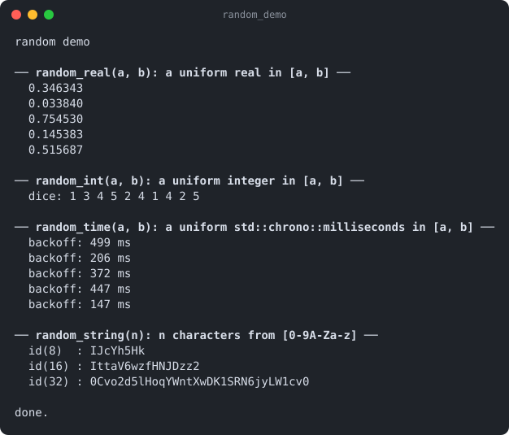

# random

Part of [Kronuz C++ Libraries](https://github.com/Kronuz/cpp-libraries), a collection of small, reusable C++ libraries.

[](https://github.com/Kronuz/random/actions/workflows/ci.yml)
[](LICENSE)


Four one-line random helpers for C++20 (a real, an integer, a duration, and an
alphanumeric string), sharing one per-thread generator so call sites need no
setup. For jitter, backoff, sampling, and throwaway ids.



## ✨ Highlights

- **No setup.** One xoshiro256++ generator per thread (32 bytes of state), seeded
  once from `std::random_device`.
- **Inclusive ranges.** `random_int(1, 6)` can return both 1 and 6.
- **Durations directly.** `random_time(100ms, 500ms)` for randomized backoff.
- **Thread-safe** without locks: each thread has its own generator.
- **No dependencies.**

## 📦 Installation

Requires a C++20 compiler and CMake 3.14 or newer; it compiles one source file.
CI builds it on Linux (x86_64, arm64), macOS (arm64, x86_64), FreeBSD, and
Windows (MSVC), plus ASan, UBSan, and TSan builds.

```cmake
include(FetchContent)
FetchContent_Declare(random
  GIT_REPOSITORY https://github.com/Kronuz/random.git
  GIT_TAG        main)
FetchContent_MakeAvailable(random)

target_link_libraries(my_app PRIVATE random::random)
```

## 🚀 Quick start

```cpp
#include "random.hh"

#include <chrono>

using namespace std::chrono_literals;

int main() {
	double jitter = random_real(0.0, 1.0);
	std::uint64_t roll = random_int(1, 6);
	std::chrono::milliseconds backoff = random_time(100ms, 500ms);
	std::string id = random_string(16);   // [0-9a-zA-Z]
}
```

[`examples/demo.cc`](examples/demo.cc) prints a few draws of each.

## 🎯 When to use it

- ✅ Timers, retries, sampling, test data, and ids that only need to be unlikely to
  collide.
- ❌ Secrets, tokens, or anything an attacker might predict: xoshiro256++ is
  not a cryptographic generator.
- ❌ Reproducible runs: seeds come from `std::random_device`.

## ⚡ Performance

`random_int` and `random_time` use Lemire's multiply-shift ranges.
`random_string` draws ten characters per 64-bit value (6-bit fields, rejecting 62
and 63, so every symbol is exactly 1/62) into a pre-sized buffer.

`random_bench` times one thread in a Release build (`-O3`, Apple clang 17) and
reports the median of nine batches:

| Call | Apple M4 Pro | Intel i9-9980HK |
| --- | ---: | ---: |
| `random_int(0, 999999)` | 2.50 ns | 5.3 ns |
| `random_int(1, 6)` | 2.46 ns | 5.2 ns |
| `random_real(0, 1)` | 2.53 ns | 6.1 ns |
| `random_time(100ms, 500ms)` | 2.50 ns | 4.8 ns |
| `random_string(8)` | 8.2 ns | 17 ns |
| `random_string(32)` | 32 ns | 83 ns |
| `random_string(256)` | 107 ns | 297 ns |

Most of an integer call is the call itself and the thread-local access. On the i9
the calls of 4 to 6 ns move by up to 1 ns with the placement of the code in the
binary: `random_int(0, 999999)` took 4.2 to 5.3 ns in different builds of the same
source.

```sh
cmake -B build -DCMAKE_BUILD_TYPE=Release -DRANDOM_BUILD_BENCH=ON && cmake --build build && ./build/random_bench
```

## 📚 Documentation

- [docs/API.md](docs/API.md): the four functions and their ranges.
- [ARCHITECTURE.md](ARCHITECTURE.md): the per-thread generator.
- [AGENTS.md](AGENTS.md): repository map and traps.
- [CHANGELOG.md](CHANGELOG.md): behavior and performance changes.

## 🛠️ Building and testing

```sh
cmake -B build && cmake --build build && ctest --test-dir build
./build/random_demo
```

## 🤝 Contributing

Issues and pull requests are welcome. Read [AGENTS.md](AGENTS.md) first. CI must
pass on every platform.

## 📄 License

MIT. See [LICENSE](LICENSE). Extracted from
[Xapiand](https://github.com/Kronuz/Xapiand).
